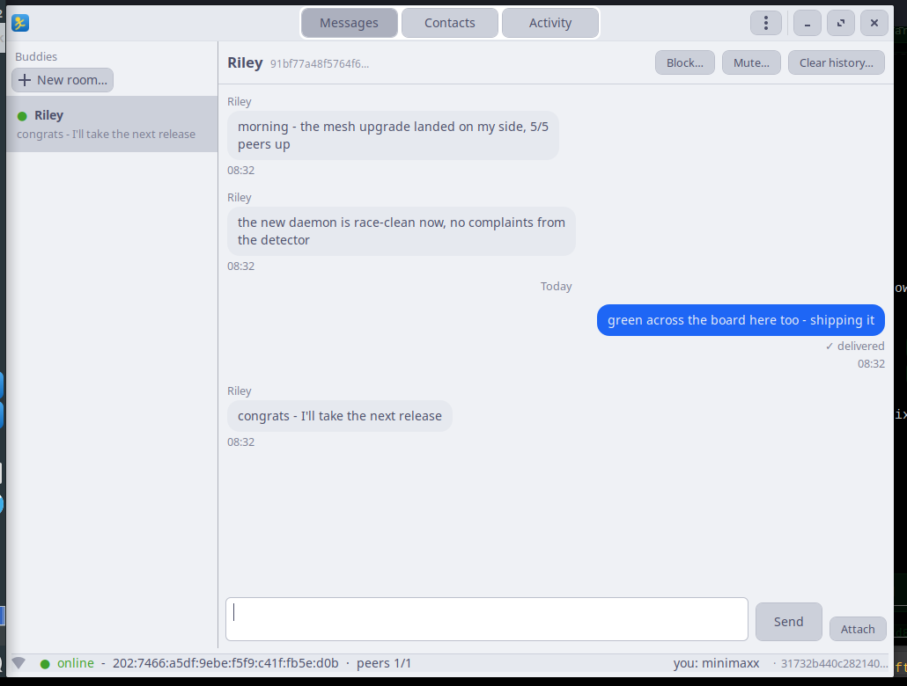

# AIMless



Serverless, end-to-end-encrypted chat over the [Yggdrasil](https://yggdrasil-network.github.io/) overlay network. No servers, no accounts, no ports to forward, no TUN device, no root.

It is AIM for the mesh era: screen names, a buddy list, away messages, and messages that wait for you until you are back.

- **End-to-end encrypted** - per-recipient NaCl sealed boxes, made by your client. The relay never sees plaintext.
- **Serverless** - your identity is an Ed25519 keypair and your address is derived from it.
- **Durable** - messages and files are journaled and retried until delivered, even if the other side is offline.
- **A desktop app and a CLI** - a GTK app with a tray icon, plus a headless command line.

---

## Try it in two minutes

### Docker - nothing to install but Docker

```sh
docker run -d --name aimless-webtop --restart unless-stopped \
  -p 127.0.0.1:8080:8080 -p 127.0.0.1:5900:5900 \
  -e VNC_PASS="aimless" \
  -v "$PWD/aimless-data:/data" \
  ghcr.io/lorenzo95/aimless/aimless-webtop:latest
```

Open <http://localhost:8080/vnc.html>, password `aimless`. The first run asks you to create an identity.

**To see two clients talk to each other**, start a second one:

```sh
docker run -d --name aimless-webtop2 --restart unless-stopped \
  -p 127.0.0.1:8081:8080 \
  -e VNC_PASS="aimless" \
  -v "$PWD/aimless-data2:/data" \
  ghcr.io/lorenzo95/aimless/aimless-webtop:latest
```

Open <http://localhost:8081/vnc.html>. In the first window choose **Contacts -> Copy**; in the second, **Contacts -> Add a buddy** and paste the invite. Say something. Now stop one container, send a message from the other, and start it again: the message is waiting for you.

> The container has no audio and no notification daemon, so sound and notifications are silent there by design. If you expose the page to the internet, put it behind TLS and a password, and change `VNC_PASS` - whoever reaches that page gets your desktop.

### On your own machine - two files, nothing to build

```sh
mkdir -p ~/.local/bin && cd ~/.local/bin
wget https://raw.githubusercontent.com/lorenzo95/Aimless/main/dist/aimlessd-linux-amd64
wget https://raw.githubusercontent.com/lorenzo95/Aimless/main/dist/aimless.pyz
chmod +x aimlessd-linux-amd64 aimless.pyz
./aimless.pyz
```

That is the whole install. The daemon is a static binary with no dependencies, and the client is Python that talks to the GTK 3 stack your desktop already has. For a second client, run `./aimless.pyz` in another terminal and copy the invite between them.

**If something is missing** (a bare container, a minimal server, a headless box):

```sh
sudo apt-get install -y python3 python3-nacl python3-gi gir1.2-gtk-3.0 python3-cairo
```

| Package | Why |
|---|---|
| `python3-nacl` | the encryption library (PyNaCl) |
| `python3-gi`, `gir1.2-gtk-3.0` | the GTK 3 bindings the app draws with |
| `python3-cairo` | only for the running-man icon - without it the app still runs, the taskbar shows a generic icon, and the app log says so |

If you have an old pip-installed client lying around, remove it first: `pip uninstall aimless-client`.

## First run

Two steps, in the window:

1. **Your identity.** There is none on this machine yet: create one (a passphrase that protects your keys, plus a screen name), or restore a backup you exported earlier.
2. **Your peers.** AIMless reaches the network through public peers. The built-in ones are nearby and checked, so you can keep them; the step also links to the current public list if you want to add one of your own. Skipping it is fine - the built-in list is already in place.

After that it is unlock, tray and window. `./aimless.pyz autostart` starts the whole stack at login.

The app that starts at login is **locked** - it does not ask for your passphrase before you click the tray icon. It still tells you when a message arrives (badge, tooltip, notification); it just cannot read it until you unlock.

## The buddy list

The list on the left is **one list**: your direct messages and your group chats, mixed the way conversations actually happen. A group you just made is a conversation, so it comes first - not at the bottom under everybody else.

Two controls sit above it:

- **A filter box.** Type and the list narrows as you type - one letter is enough. It matches the name you see and the buddy name behind it, so `ana` finds *Ana*. Clear it and everything is back.
- **An order button**, the little arrow next to *Buddies*. Click it to switch order; it remembers which one you chose.

| Order | What it does |
|---|---|
| **recent** (the default) | the conversation that happened last is on top, conversations with unread messages come first, the rest follow by time. A conversation that never had a message keeps a quiet spot at the bottom instead of churning |
| **by name** | a phone book, A to Z |

The conversation you are reading does not jump when a new message lands in it - the row stays where it is, so the text does not slide away under your eyes. Every other conversation moves when it should.

## What the tray is telling you

| Icon | Meaning |
|---|---|
| yellow running man | attached - your buddies see you as available |
| yellow + red badge | attached, and something is unread (or waiting, if the app is still locked) |
| **amber running man** | **at risk** - one peer is left, so that one link is the only way in and out |
| **red running man** | **not attached** - the daemon is not hearing us, or no peer is up. Your buddies see you as offline |
| red + red badge | not attached *and* something is unread |

The tooltip says why, the right-click menu shows the same state as a *Status:* line, and a notification fires when you go offline and again when you come back.

The node is on the network as long as **one** peer is up, so the count alone is not the interesting number - the redundancy is:

| Peers up | What the tray shows | Why |
|---|---|---|
| all of them | yellow | nothing to say |
| two or more | yellow | still more than one way in and out, so losing a few peers is not worth a warning |
| **exactly one** | **amber** | that link is the only way through - one failure from being cut off |
| none | **red** | the node is an island; nobody can reach you |

A daemon that was deliberately configured with a single peer is not warned about: it has all the redundancy it asked for.

Two different things can break, and both end up on the red icon with a different reason:

| What broke | How we notice | The reason it shows |
|---|---|---|
| the app cannot reach the daemon | our heartbeat stops landing | *the daemon is not answering* |
| the daemon died | the supervisor notices and restarts it | *the daemon died - restarting* |
| the ssh tunnel is down (remote mode) | the tunnel process is gone | *the ssh tunnel is down* |
| the daemon is alive but has **no peer up** | the daemon's peer list | *no Yggdrasil peers - the daemon is on an island* |

The last one is the subtle one: the daemon answers, the app is happy, the window looks fine - and the node still cannot reach the overlay network, so nobody can reach you.

## Peers

`aimlessd` is an embedded Yggdrasil node, so it needs **peers** to reach anyone else. Out of the box it dials five of them, from five different operators, each pinned to its public key:

```
tls://ca.us.ygg.informatics.coop:443?key=0000000023fc6ffb62afb79448aefb0943df2e4472cf08bd489f5407378300a2
tcp://ip4.nerdvm.mywire.org:8080?key=00000000c61d731961a290d127cd3fc03a4c5f3f35b9083559d4c81d48d65854
tls://ygg8.mk16.de:1338?key=0000000b0683e38d8cb3085cfbf217edf0f0b2de76bb5ac7f02a94cd42a3fed9
tcp://no0.yggdrasil.netralex.com:65533?key=f4b9fe4f9923834b1c20f84e13b14d90ecde443f78613ec54cf484eea6880fea
tls://nl1.route172.de:443?key=000000002643ae27bad63e2a81f1d30554ce9ea634f5990062a9e079e23593cd
```

**Public peers rot.** Operators go away, and a domain that lapses gets parked - the hostname resolves to `0.0.0.0`, which connects to localhost and is refused instantly. That is not a hypothetical: it is how this daemon once ended up with no peers at all. So:

- a peer whose hostname does not resolve is **refused at startup** and shown as broken, instead of being dialled forever;
- the live list, refreshed hourly, is at <https://publicpeers.neilalexander.dev/> - and the peer manager has a **Browse the public peer list** button, so you do not have to go looking for the URL;
- the machine-readable version of the same list is at <https://github.com/Yggdrasil-Unofficial/pubpeers> (`peers.json`).

**Options -> Peers ...** opens the peer manager: every peer with its live state (up or down, round trip time, traffic, and the reason if one could not be used), a Remove button each, a field to add one, and a **Restore the built-in peers** button. Changes are applied immediately - no restart - and the daemon writes them to its own `config.json`, so the file and the running daemon never disagree.

| Where | How | Notes |
|---|---|---|
| **The app** | **Options -> Peers ...** | The easy way. Applies right away. |
| `daemon/config.json` | `"peers": [...]` | The same file the app writes. |
| `aimlessd -peers` | `-peers uri1,uri2` | Overrides the file entirely (replaces, never merges). `-peers none` runs with no peers at all. |
| built-in | `defaultPeers` in `daemon/main.go` | Used when neither of the above is set. |

The `?key=` option pins the peer's public key: the peer has to present exactly that key, so an IP that gets reassigned cannot pass itself off as the node you meant to reach. Keep the list short - every extra peer is another node you relay traffic for.

> Routing to another AIMless node takes a moment the first time - Yggdrasil refreshes its routing table every few minutes, so a message to a never-before-seen peer can take a minute or two to find its way. Queued messages retry on their own, so nothing is lost while the route is being worked out.

**Running your own peer** is the only way to be sure of being reachable. A $4 VPS running `aimlessd -listen tcp://0.0.0.0:1234` is enough; put it in the peer list and you no longer depend on anybody else's uptime.

## Where things live

Everything lives under one root - `~/.local/share/aimless` by default, or `$AIMLESS_HOME`. `aimless paths` prints the resolved locations.

```
~/.local/share/aimless/
├── client/    identity.json - contacts.json - state.db - prefs.json - attachments/
├── daemon/    node.key - config.json - aimless.db - contacts.json - blocked.json - lock - api.sock
├── logs/      app.log - daemon.log - tunnel.log
└── run/       app.pid - aimlessd.pid - tunnel.pid
```

Three things live outside the root, because the desktop spec pins them there:

| What | Where | Why |
|---|---|---|
| Login autostart entry | `~/.config/autostart/aimless-tray.desktop` | the desktop spec pins it there |
| App icon | `~/.local/share/icons/hicolor/*/apps/aimless*.png` | it has to sit in the icon theme for the taskbar and shell to find it |
| Desktop entry | `~/.local/share/applications/aimless.desktop` | without it the taskbar cannot match the window to the app |

That last one matters more than it looks: with no desktop entry the taskbar shows a generic placeholder instead of the app icon, and right-clicking it offers no application menu - because there is no application for the shell to build one from. The entry carries `Icon=aimless` and `StartupWMClass=aimless`, which have to match the `WM_CLASS` the window advertises.

The icon is the AIM *running man* - yellow on a blue tile - drawn with Cairo at startup (the repo carries no binary assets) and written into the icon theme. It is only rewritten when it changes. Every window the app opens carries it, including the unlock dialog that is on screen before you type your passphrase.

> **Upgrading from an older version?** The on-disk layout changed once; old files are not migrated. To keep your identity, **export a backup first** (Keys & Identity -> *Export encrypted backup*) or copy `identity.json` and `node.key` by hand, then use **Import backup...** on the first-run screen. Message history and attachments are not preserved by the backup.

## Keys, identity and the CLI

Header menu -> **Keys & Identity ...**

- **Yggdrasil node key** - see your address, or set a specific one (paste 64/128-hex from a vanity generator), generate a random one, or reset to default. The address is previewed; applying restarts the daemon. Changing it changes your address, so old invites go stale.
- **Client identity** - replace your encryption key from a 64-hex seed. This breaks existing conversations; restart AIMless afterwards.
- **Backup & restore** - one passphrase-encrypted bundle (identity seed, node key, screen name, contacts). Restoring overwrites your keys.

Keys are written `0600` and atomically, and seeds are never logged.

The CLI does the same things without a window: `aimless init`, `invite`, `add <invite> [petname]`, `list`, `send`, `chat`, `away`, `gui`, `tray`, `paths`, `stop` - see `aimless --help`.

## Always-on daemon (optional)

By default the client owns a local daemon: if your machine is off, a message sent to you waits on the sender until you are back. To never miss one, run the daemon on an always-on host (a small server, a Pi, a VPS) and let the client reach it over SSH.

1. On the always-on host, run the daemon-only container (see `deploy/docker/README.md`), seeding your existing `node.key` so your address does not change.
2. On the client, add a `remote` block to `client/prefs.json` (`aimless paths` shows where that is):
   ```json
   "remote": {
     "host": "user@always-on-host",
     "socket": "/abs/path/aimless-data/daemon/api.sock"
   }
   ```
   Your SSH key has to be authorized on the host. The client opens the tunnel itself - you do not run ssh by hand.
3. Start AIMless as usual. The bar shows the tunnel host; the tunnel is monitored and restarted automatically if it drops (after the laptop wakes, for instance).

The daemon holds ciphertext and the node key only - your identity stays on the client. **One client per daemon.** A daemon-only host has no client attached by design, so from the buddies' side that node shows as *client offline - messages will be delivered* until a client connects over the tunnel.

---

## How it works

```
+-----------+  unix socket  +-----------+   encrypted packets  +-----------+  unix socket  +-----------+
|  client   | ------------> |  aimlessd | --------------------> |  aimlessd | ------------> |  client   |
| (Python)  |    NDJSON     |   (Go)    |  Yggdrasil overlay   |   (Go)    |    NDJSON     | (Python)  |
+-----------+              +-----------+                       +-----------+              +-----------+
   plaintext                ciphertext                     ciphertext              plaintext
   in RAM only              journals on disk               journals on disk        in RAM only
```

The **client** owns identity, encryption and display. The **daemon** is a dumb, durable relay: it journals ciphertext, retries until ACKed, stores file chunks and probes presence - it **never sees plaintext**. The transport is an embedded (no TUN) Yggdrasil node, and every peer is addressed by its node key.

| Piece | Language | Role |
|---|---|---|
| `daemon/` | Go | embedded Yggdrasil core, packet transport, journals/retry/ACK, attachments, blocklist, presence, local JSON API on a Unix socket |
| `client/` | Python | identity, contacts, encrypted SQLite state, GTK app (rooms, files, themes, prefs) + CLI |
| `deploy/` | - | webtop image, `package.sh` release builder, `check_dist.py` gate, two-node smoke test |

### Security model

- **Identity** is a client Ed25519 keypair. Your invite (`aimless1:<client-pk>:<node-pk>:<screen>`) carries the client key (what friends encrypt to) and the node key (where to route). The Yggdrasil address is derived from the node key.
- **E2E encryption** - per-recipient NaCl sealed boxes made by the client. Every message is Ed25519-signed and verified against the claimed sender, independently of the transport.
- **The daemon cannot read messages, names, filenames or status.** It sees routing metadata only.
- **No forward secrecy** - long-term keys, no ratchet. Anyone with your private key can decrypt past traffic; treat it like email, not Signal.
- **Encrypted at rest** - history is an encrypted SQLite database (`state.db`, scrypt key), and so is the identity file. The **one exception is attachment bytes**, written to `client/attachments/<conv>/` in plaintext so images can render and save locally.
- Experimental alpha - not for security-critical use.

### Under the hood

Each datagram is an envelope over ironwood's encrypted `PacketConn`: a 20-byte header (`version=1`, `type`, `seq` uint64, `ts` ms, `payload_len`) plus the payload. Types: `MSG`, `ACK`, `STATUS`, `PROBE`, `FILE`.

- **MSG** - a sealed box from the sender's client. ACKed; the sender retries until then.
- **STATUS** - a sealed screen/away blob. The daemon only sends the client's real status while a client has been active recently (a heartbeat); with no client attached it sends an **empty STATUS** as a "mailbox" marker, so buddies see *"client offline - messages will be delivered"* instead of available. On the receiving side an away buddy is **amber**, not green: reachable is not the same as at the keyboard.
- **PROBE** - a presence ping. Liveness comes from probe/status only, never from message traffic, so a clientless always-on daemon can age out of buddies' presence while it still relays and ACKs.
- **FILE** - a 20-byte cleartext routing header (transfer id, chunk index and total) plus a sealed chunk body. The daemon keys and joins the chunks, but the filename, MIME type, hash and contents stay encrypted. Chunks persist until the client reassembles and verifies them (SHA-256), and consumption is ACKed.

Inside a MSG payload: `{"v":1,"kind":"msg","from":<hex>,"body":<canonical JSON>,"sig":<b64>}`, where `body` is `{"text","ts"}` plus an optional `screen`, and for rooms `conv` (SHA-256 of the sorted member node keys) and `members`. `sig` is Ed25519 over `aimless\x01 + body`.

**Rooms** are three or more members, fanned out client-side (one sealed copy per member, with the normal retry and ACK). Membership is learned from signed messages, so nobody can impersonate anybody. History is one sync stream per peer, routed by `conv` with a single watermark; clearing or deleting a room dismisses the backlog, and muting keeps the history but stays silent.

| Type | The daemon knows | The daemon cannot know |
|---|---|---|
| MSG | destination, seq, timestamp, size | text, screen name |
| FILE | transfer id, chunk index/total, size | filename, MIME type, hash, contents |
| STATUS/PROBE | source, timestamp | screen name, away message |

The local API is a Unix socket speaking newline-delimited JSON; requests may carry an `id` that is echoed on the reply. Ops: `whoami`, `status`, `send`, `sendfile`, `history`, `watch`, `setstatus`, `setpeers`, `presence`, `block`/`unblock`/`blocklist`, `pendingattachments`/`fetchattachment`/`ackfile`. Events: `recv` and `acked`.

More detail lives in **[docs/networking.md](docs/networking.md)** (peers, listeners, the mesh) and **[docs/always-on-daemon.md](docs/always-on-daemon.md)** (running the daemon on a host that never sleeps).

## Building from source

```sh
cd daemon && go build -o aimlessd . && ./aimlessd -datadir ~/.local/share/aimless/daemon
cd ../client && pip install . && aimless
```

## Development

```sh
cd daemon && go test ./...       # codec, journals, delivery, presence, integration
cd client && pytest tests/       # crypto, protocol, store, real-daemon e2e, GTK
cd deploy && python3 smoke.py    # two-node deployment, including offline delivery
./deploy/package.sh              # build the versioned dist/ artifacts
python3 deploy/check_dist.py     # release gate: the committed dist matches the source
```

## Status

Experimental. Both Yggdrasil and AIMless are alpha - not for security-critical use.

---

*Developed with heavy AI assistance: most of the code, the packaging and this README are produced collaboratively with large language models. Review carefully and audit what you run; releases and images are human-reviewed and tested before publishing.*
